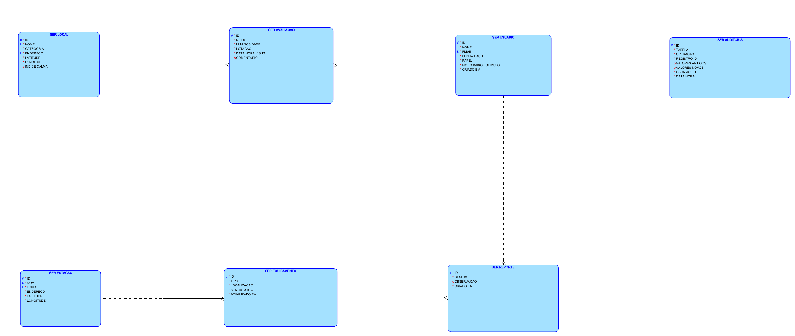
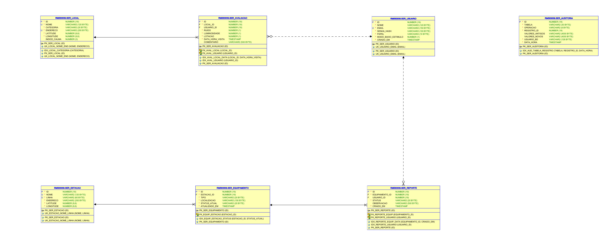
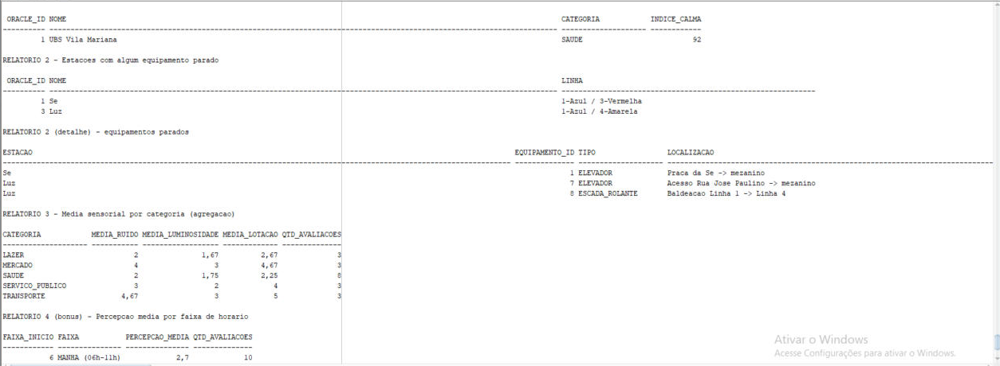
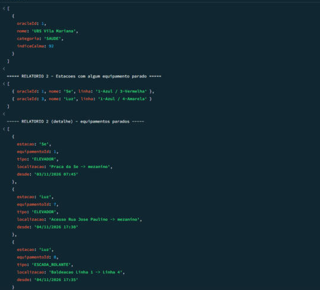
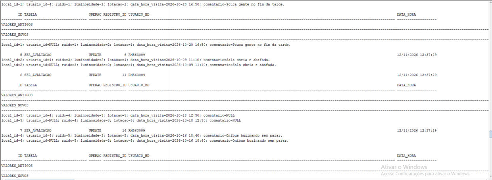
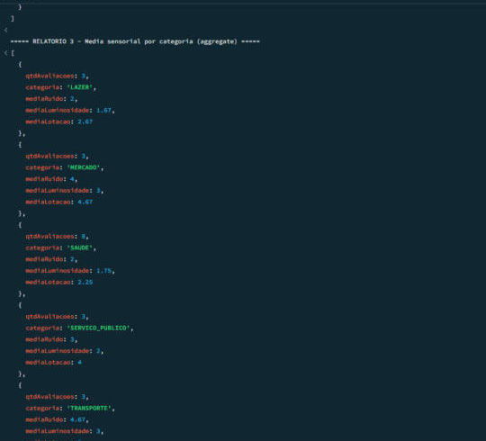

# Sereno — Do Oracle ao MongoDB

**Global Solution FIAP 2026/2 — CitizenTech** · Disciplina *Mastering Relational and Non-Relational Database* · Turma 2TDSPI

Repositório: https://github.com/FelypeMaschio/GS-Sereno-Banco

| RM | Nome |
|---|---|
| RM562156 | Pedro Henrique dos Santos Costa |
| RM565269 | Eduardo Augusto de Oliveira Souza |
| RM564673 | Fellipe Costa de Oliveira |
| RM563009 | Felype Ferreira Maschio (responsável pelo banco de dados) |
| RM563304 | Gustavo Vieira de Matos |

---

## 1. O problema CitizenTech

Para muitas pessoas, sair de casa exige planejamento. Uma pessoa autista, com TDAH ou ansiedade pode passar mal num lugar barulhento, iluminado demais ou lotado. Um cadeirante, um idoso ou alguém com carrinho de bebê pode ficar preso numa estação de metrô porque o único elevador está parado — e só descobre isso quando chega lá.

O **Sereno** avisa **antes de sair de casa** se o destino e o caminho são acessíveis, unindo duas frentes alimentadas pelos próprios cidadãos:

- **Calmaria (mapa sensorial):** avaliações de ruído, luminosidade e lotação (1 = calmo, 5 = intenso) geram o **índice de calma** de 0 a 100 de cada lugar e mostram o horário mais tranquilo para ir.
- **Elevador Funciona?:** reportes em tempo real do status de elevadores, escadas rolantes, rampas e plataformas das estações.

**ODS atendidos**

| ODS | Como o Sereno contribui |
|---|---|
| **10 — Redução das desigualdades** | Dá às pessoas com deficiência e neurodivergentes a mesma informação de que precisam para circular com autonomia (meta 10.2, inclusão social). |
| **11 — Cidades sustentáveis** | Mapeia a acessibilidade real do transporte público e dos serviços, e entrega ao gestor dados sobre equipamentos parados (metas 11.2 e 11.7). |
| **3 — Saúde e bem-estar** | Reduz crises sensoriais e o estresse de deslocamento ao indicar lugares e horários mais calmos (meta 3.4, saúde mental). |

## 2. Arquitetura dos dados

| Banco | Papel |
|---|---|
| **Oracle** | Banco real da API Java (usuários, locais e avaliações) e modelo completo da solução, com as regras de negócio em PL/SQL. |
| **MongoDB** | Representação documental dos **mesmos dados**, criada por scripts, para comparar os dois modelos. |

Não há integração automática entre os bancos (não é exigida). A transição é demonstrada pelos scripts e pela comparação dos relatórios, que dão **o mesmo resultado** porque os dois lados usam os mesmos dados de exemplo e cada documento guarda o `oracleId` da linha de origem.

## 3. Modelo relacional (Oracle)

**Modelo lógico** (SQL Developer Data Modeler)



**Modelo relacional**



PDFs: `1_Oracle/Modelo_Logico.pdf` e `1_Oracle/Modelo_Relacional.pdf`.

| Tabela | Descrição | Regras principais |
|---|---|---|
| `SER_USUARIO` | Cidadão ou gestor | e-mail único e minúsculo; `papel` CIDADAO/GESTOR; `modo_baixo_estimulo` 0/1 |
| `SER_LOCAL` | Lugar do mapa sensorial | 6 categorias; `indice_calma` 0 a 100 (NULL = sem avaliações) |
| `SER_AVALIACAO` | Notas sensoriais | notas 1 a 5; FK para local; FK para usuário com `ON DELETE SET NULL` (anonimização LGPD) |
| `SER_ESTACAO` | Estação de metrô | nome + linha únicos |
| `SER_EQUIPAMENTO` | Elevador, escada rolante, rampa, plataforma | `status_atual` = último reporte (mantido por gatilho) |
| `SER_REPORTE` | Reporte de status feito pelo cidadão | status FUNCIONANDO / PARADO / EM_MANUTENCAO |
| `SER_AUDITORIA` | Trilha de auditoria | data, operação, valores antigos e novos; sem FK para sobreviver ao DELETE |

**Fórmula do índice de calma:** `ROUND(100 - (média de (ruído + luminosidade + lotação) / 3 - 1) * 25)` → média 1 = 100 (muito calmo), média 5 = 0.

### Objetos PL/SQL

| Requisito | Objeto | Regra de negócio |
|---|---|---|
| Bloco 1 (cursor) | `05_blocos.sql` | Lista os locais críticos (índice de calma < 40) |
| Bloco 2 (IF + LOOP) | `05_blocos.sql` | Classifica cada estação em ACESSÍVEL, PARCIAL ou INACESSÍVEL e alerta elevador parado |
| Função 1 | `pkg_calmaria.fn_indice_calma` | Índice de calma de um local (chamada pela API Java via `SELECT ... FROM dual`) |
| Função 2 | `pkg_acessibilidade.fn_equipamentos_parados` | Equipamentos parados ou em manutenção de uma estação |
| Procedimento 1 | `pkg_calmaria.prc_registrar_avaliacao` | Valida notas, local, usuário e data; insere e recalcula o índice do local |
| Procedimento 2 | `pkg_acessibilidade.prc_registrar_reporte` | Valida status, equipamento e usuário; insere o reporte |
| Gatilho 1 (auditoria) | `trg_aud_avaliacao` | AFTER INSERT/UPDATE/DELETE em `SER_AVALIACAO`, grava `:OLD` e `:NEW` |
| Gatilho 2 | `trg_reporte_atualiza_status` | AFTER INSERT em `SER_REPORTE`, atualiza o status do equipamento |
| Pacotes | `pkg_calmaria`, `pkg_acessibilidade` | Specification + body; exceções nomeadas |
| Bônus | `pkg_acessibilidade.fn_posso_ir_agora` | Junta o índice de calma do local com a situação da estação mais próxima |

**Códigos de erro:** -20001 nota inválida · -20002 local inexistente · -20003 usuário inexistente · -20004 visita no futuro · -20005 equipamento inexistente · -20006 status inválido · -20007 estação inexistente.

## 4. Mapa relacional → documental

| Oracle | MongoDB | Decisão | Por quê |
|---|---|---|---|
| `SER_USUARIO` | collection **`usuarios`** | documento próprio, **referenciado** por `usuarioId` | o usuário é compartilhado por avaliações e reportes e muda pouco; incorporar duplicaria nome e e-mail em todo lugar. `senha_hash` **não** é migrada (dado sensível). |
| `SER_LOCAL` | collection **`locais`** | documento principal | é a entidade que o app abre |
| `SER_AVALIACAO` | array **`locais.avaliacoes`** | **incorporada** | sempre lida junto com o local; um local tem poucas dezenas de avaliações; o índice de calma é calculado a partir delas |
| `SER_ESTACAO` | collection **`estacoes`** | documento principal | é a tela do "Elevador Funciona?" |
| `SER_EQUIPAMENTO` | array **`estacoes.equipamentos`** | **incorporado** | o app sempre abre a estação com os equipamentos; são poucos por estação |
| `SER_REPORTE` | array **`equipamentos.ultimosReportes`** | **incorporado parcialmente** (padrão *subset*: só os 5 mais recentes) | a tela mostra os últimos reportes; o histórico completo cresceria sem limite, então fica fora do documento |
| `SER_AUDITORIA` | — | **não migrada** | é controle interno do Oracle, gerada por gatilho |
| `id` de cada tabela | campo **`oracleId`** | índice único | prova a correspondência entre linha e documento |
| `CHECK` | `$jsonSchema` no `createCollection` | validação | notas 1-5, enums de categoria, tipo e status |
| FK | `usuarioId` + `$lookup` | referência | o `$lookup` faz o papel do JOIN quando o nome do autor é necessário |
| latitude/longitude | `localizacao` GeoJSON + índice `2dsphere` | adaptação | permite buscar "perto de mim" no MongoDB |

**Quando referenciar e quando incorporar:** incorporamos o que é lido junto, pertence a um único pai e tem crescimento limitado (avaliações, equipamentos, últimos reportes). Referenciamos o que é compartilhado entre vários documentos ou muda de forma independente (usuário).

**E se as avaliações crescerem muito?** Um documento MongoDB tem limite de 16 MB. Com milhares de avaliações por local, a solução seria o mesmo padrão *subset* usado nos reportes: manter só as N mais recentes no local e mover o histórico para uma collection `avaliacoes` com referência ao local.

## 5. Relatórios: Oracle × MongoDB

Os resultados abaixo são os esperados com os dados de exemplo e são **idênticos** nos dois bancos.

### Relatório 1 — Locais de saúde com índice de calma ≥ 70 (filtro)

| | Consulta |
|---|---|
| Oracle | `SELECT ... FROM ser_local WHERE categoria = 'SAUDE' AND indice_calma >= 70` |
| MongoDB | `db.locais.find({ categoria: "SAUDE", indiceCalma: { $gte: 70 } })` |

| oracleId | nome | categoria | índice |
|---|---|---|---|
| 1 | UBS Vila Mariana | SAUDE | 92 |

(A UBS Pinheiros, com índice 58, fica de fora.)

### Relatório 2 — Estações com algum equipamento parado (consulta em array × EXISTS)

| | Consulta |
|---|---|
| Oracle | `SELECT ... FROM ser_estacao e WHERE EXISTS (SELECT 1 FROM ser_equipamento q WHERE q.estacao_id = e.id AND q.status_atual = 'PARADO')` |
| MongoDB | `db.estacoes.find({ "equipamentos.statusAtual": "PARADO" })` |

| oracleId | estação | linha | equipamentos parados |
|---|---|---|---|
| 1 | Se | 1-Azul / 3-Vermelha | elevador (desde 03/11 07:45) |
| 3 | Luz | 1-Azul / 4-Amarela | elevador e escada rolante (desde 04/11) |

(Paraíso não aparece: o equipamento dela está `EM_MANUTENCAO`, não `PARADO`.)

### Relatório 3 — Agregação: média sensorial por categoria

| | Consulta |
|---|---|
| Oracle | `SELECT categoria, ROUND(AVG(ruido),2), ... FROM ser_avaliacao JOIN ser_local ... GROUP BY categoria` |
| MongoDB | `db.locais.aggregate([{ $unwind: "$avaliacoes" }, { $group: { _id: "$categoria", ... } }, { $project: { $round } }, { $sort }])` |

| categoria | ruído | luminosidade | lotação | avaliações |
|---|---|---|---|---|
| LAZER | 2 | 1.67 | 2.67 | 3 |
| MERCADO | 4 | 3 | 4.67 | 3 |
| SAUDE | 2 | 1.75 | 2.25 | 8 |
| SERVICO_PUBLICO | 3 | 2 | 4 | 3 |
| TRANSPORTE | 4.67 | 3 | 5 | 3 |

### Relatório 4 (bônus) — "Mapa de calor" por faixa de horário

Oracle com `CASE` + `GROUP BY`; MongoDB com `$hour` + `$bucket`. Percepção = média de (ruído + luz + lotação) / 3 (menor = mais calmo).

| faixa | percepção média | avaliações |
|---|---|---|
| MANHÃ (06h-11h) | 2.7 | 10 |
| **TARDE (12h-17h)** | **2.5** (mais calma) | 8 |
| NOITE (18h-23h) | 4.33 | 2 |

### Evidências de execução

Os prints completos estão em `3_Documentacao/Documentacao_Sereno.pdf` (seção 5). Os principais:

| Oracle (SQL Developer) | MongoDB (Compass) |
|---|---|
|  |  |
|  |  |

O arquivo único Oracle foi executado duas vezes seguidas sem erros; as saídas completas estão em `1_Oracle/saida_execucao_1.txt` e `1_Oracle/saida_execucao_2.txt`.

## 6. Como executar

### Oracle (SQL Developer)

Abrir `1_Oracle/Sereno_Oracle_Completo.sql` e executar com **F5 (Executar Script)**, de cima para baixo, numa única passada. O script começa removendo o que existir, então pode ser executado quantas vezes for preciso. Requer Oracle 12c ou superior.

| Parte | Conteúdo |
|---|---|
| 1 | DDL: 7 tabelas, PK, FK, CHECK, UNIQUE e índices nas FKs |
| 2 | Dados de teste e reposicionamento das colunas IDENTITY (`START WITH LIMIT VALUE`) |
| 3 | Pacotes `pkg_calmaria` e `pkg_acessibilidade` (specification e body) |
| 4 | Gatilhos `trg_aud_avaliacao` e `trg_reporte_atualiza_status` |
| 5 | Blocos anônimos (cursor; IF + LOOP) |
| 6 | 21 testes de sucesso e erro; termina com ROLLBACK |
| 7 | Relatórios equivalentes aos do MongoDB |

### MongoDB (Compass ou mongosh)

| Ordem | Arquivo | O que faz |
|---|---|---|
| 1 | `2_MongoDB/1_estrutura_collections.js` | `use('sereno')`, cria as 3 collections com validação e índices |
| 2 | `2_MongoDB/2_carga_documentos.js` | `insertMany` de 16 documentos (5 usuários, 6 locais, 5 estações) |
| 3 | `2_MongoDB/3_relatorios_comparacao.js` | `find` e `aggregate` dos relatórios |

No terminal: `mongosh --file 2_MongoDB/1_estrutura_collections.js` (e assim por diante). No Compass: abrir o shell **>_MONGOSH**, colar o conteúdo do arquivo e apertar Enter.

### Usuários de teste

Todos os 5 usuários usam a senha **`Sereno@2026`**, gravada como hash BCrypt (custo 10) em `senha_hash`.

| id | e-mail | papel |
|---|---|---|
| 1 | ana.souza@email.com | CIDADAO |
| 2 | bruno.lima@email.com | CIDADAO |
| 3 | carla.mendes@email.com | CIDADAO |
| 4 | diego.rocha@email.com | CIDADAO |
| 5 | gestor@sereno.app | GESTOR |

Os dados de locais e estações usam nomes reais de São Paulo (sem acentos nos scripts, para não depender da codificação do SQL Developer); endereços e coordenadas são aproximados.

## 7. Estrutura do repositório

```
1_Oracle/        Sereno_Oracle_Completo.sql · Modelo_Logico.pdf · Modelo_Relacional.pdf · saida_execucao_1.txt · saida_execucao_2.txt
2_MongoDB/       1_estrutura_collections.js · 2_carga_documentos.js · 3_relatorios_comparacao.js
3_Documentacao/  Documentacao_Sereno.pdf · img/
LEIA-ME.txt
README.md
```
